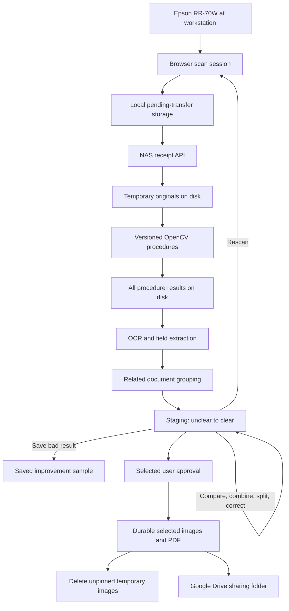

# Receipt automation design and decisions

Status: Proposed, subject to hardware and sample tests.
Parent: [Epic](receipt-automation-epic.md)
Tasks: [Work items](receipt-automation-work-items.md)

## 1. System boundary

The NAS does not control USB. After the NAS confirms a durable save, processing can continue without the scan tab. Before that point, the browser must retain the scan or show that it is not yet safe.

All results enter staging. A clear result is not an approved result. Upload requires the user to select and approve the current version.

Moving OCR to the NAS does not by itself remove the scanner driver's need for `SharedArrayBuffer` or isolation headers.

## 2. Initial service shape

Start with one application service, a bounded worker pool, a durable database-backed job queue, and persistent file storage. A separate message broker is not required for the initial workload.

SQLite plus files is a proposed choice. Verify locking and durability on the actual NAS volume. Do not put SQLite on an unsupported network filesystem. Choose a server database if needed.

Select the server language after RA-04 and RA-05. JavaScript can reuse interface code; Python can simplify access to OpenCV and OCR tools. Do not move the Python scanner script to the NAS.

## 3. Documents, groups, and evidence

A capture is a scanned page. A document is an itemized receipt, payment receipt, original purchase receipt, return receipt, or unknown document. A group contains related documents and becomes one approved PDF. Keep stable IDs independent of group membership and filenames.

| Record | Required information |
| --- | --- |
| Capture | ID, checksum, temporary original location, dimensions, DPI, scan settings, capture time, receive time, retention state. |
| Document | ID, ordered captures, document type, purchase/return fields, current source version. |
| Group | ID, ordered document IDs, relationship types, grouping evidence, naming date/time, confidence level, version, approval state. |
| Procedure | ID, immutable version, OpenCV operations and parameters, supported inputs, enabled state, test results. |
| Procedure run | Capture and procedure versions, output checksum/location, quality measures, automatic rank, runtime, failure, selection and feedback events. |
| Extraction | Engine/version, input result, text and regions where available, candidate fields, validation results. |
| Correction | Prior and confirmed value, author, time, reason, source and group version. |
| Job | Type, source/group version, state, attempts, lease expiry, safe error summary, next retry time. |
| Approval/export | Approved membership, page order, selected image versions, fields, filename, PDF checksum, Drive ID/link, author and time. |
| Saved sample | Pinned original and results, run manifest, problem description, optional expected result, retention setting. |

Capture time is not purchase time. Preserve each document's date separately. A return does not change the original purchase date or imply a negative original total. Do not invent a timezone from the NAS timezone.

A rescan adds a capture and invalidates affected results. Exact transfer retries are duplicate requests. Separate purchases with the same amount and date are not necessarily duplicate receipts.

### Automatic grouping

Use evidence such as merchant, transaction/reference number, terminal approval code, date/time, currency, amount, and explicit original-sale references. Receipt type determines which evidence is useful. Scan order alone is insufficient.

- Itemized plus payment: compare transaction identity and totals, with a tested tolerance for time and payment adjustments.
- Original plus return: prefer an explicit original-sale reference. Dates and amounts can differ; returns can be partial or repeated.
- Missing or conflicting evidence: keep separate or mark the proposed group unclear.
- Do not join a chain of documents solely because each pair shares a weak feature. Check the complete group's consistency.

Run automatic grouping on staged documents. For a match to an already uploaded original, show a proposed revision with its existing Drive link. Do not silently modify an approved group or upload. Require approval of the revised group; use retained selected images when the old originals no longer exist.

The user can combine groups, split groups, move documents, and change page order. Keep every page and its source identity. Store these changes as versions so late jobs cannot undo them.

## 4. Scanner release and recovery

Session states: `disconnected → connecting → ready → reading → ready`, with `stopping` and `recovery_needed` for faults.

Closing or refreshing the tab should release the scanner without a separate user action. An explicit disconnect control can remain for recovery, but is not part of the normal workflow.

Test the backend and WebUSB behavior during idle, start, read, tab close, refresh, and browser crash. Use bounded device operations and verified cancel/close paths. Test short-lived device claims or other ownership designs where the backend supports them. A worker or browser lock alone is not a physical-device release guarantee.

Unload and page lifecycle handlers provide best-effort cleanup only. Do not depend on an asynchronous close completing during unload. A rejected promise does not prove that a device operation stopped. Verify that a new tab can reconnect without cable removal. Report any remaining browser/OS restriction explicitly.

Only one owner may issue scanner operations. Prevent competing tabs and recover stale application locks. Do not reintroduce the 30-second idle cutoff as the normal session boundary.

## 5. Staging, confidence, and approval

Processing states: `local_pending → received → processing → staged`.

A staged group has a separate clarity state: `unclear`, `clear`, or `not_assessed`. Put unclear and not-assessed groups before clear groups. Within those classes, sort lower confidence first, then by a stable capture-order key. Mark active processing and failures separately; neither counts as clear.

Show:

- Thumbnail, page count, document types, grouping reason, and naming date/time.
- Image, extraction, and grouping confidence separately, plus an overall level.
- Missing fields, contradictory evidence, weak print, possible missing pages, and filename conflicts.
- Original and every procedure result, with the automatic choice and the user's selected result.
- Controls for correction, combine, split, reorder, rescan, save sample, selection, and approval/upload.

Use levels such as low, medium, and high until labelled tests support a calibrated probability. A model's self-reported confidence is not a measured probability. Overall clarity must account for the weakest required check, not hide it in an average.

Selection alone does not approve a group. The approval action checks the exact membership, fields, page order, selected results, and version shown to the user. Return changed or invalid items to staging with a reason. Report batch success and failure per group. Do not upload unselected items.

Allow explicit acknowledgment of poor readability if the user wishes to keep a poor receipt. Missing required naming fields or unresolved collisions still need a naming decision. Confirmation does not change the recorded machine confidence or prove that every field is correct.

Approval flow: `staged → approval_preparing → approved → drive_pending → shared`.

Before committing approval, create and verify selected per-page processed master images and the approved PDF. Commit the approval record and retryable Drive job only when those files are durable. A preparation failure leaves the group staged and retains every temporary image.

Changes after approval create a new staged revision. They never silently rewrite the approved upload. A late extraction or grouping job must not replace user corrections.

## 6. Image procedures and performance history

Revise the OpenCV process to optimize readability, with readable binary output as the preferred result. Run a bounded series of named, versioned procedures on each original. Store every result on NAS disk until approval, not only in browser memory.

Candidate operations can include orientation, deskew, cautious crop, illumination correction, contrast adjustment, denoising, and different adaptive threshold methods. Test faint strokes and edge text before using morphology or corner filling. Include an unchanged or grayscale reference so ranking can detect detail loss.

Rank results using multiple measures: content preservation, clipping, stroke loss, noise, and OCR agreement. OCR confidence alone is insufficient. A cleaner-looking image can lose digits. Keep candidate count, time, memory, and disk use bounded. Failed procedures get run records, not fabricated output images.

Show all completed results in staging. A user can choose a different result for each page. If no binary result is readable, keep the group unclear and offer rescan, sample saving, an explicitly selected grayscale/color fallback, or optional procedure generation.

Keep an append-only history of procedure attempts and selection events, including:

- Procedure and input versions, measures, rank, runtime, and failures.
- Whether it was the automatic best result.
- Whether a person inspected, selected, rejected, or replaced it.
- Reason for an override and whether the receipt was saved as a sample.

Summaries show attempts, automatic selections, confirmed selections, overrides, failures, and runtime by version and receipt condition over time. Separate automatic acceptance from active human comparison. Do not treat all approval events as verified image-quality labels. Retain numeric results and checksums after temporary images are deleted; show when a historical image is no longer available.

## 7. Optional LLM procedure proposal

If the best stored result is still poor, the user can request a new procedure. This is RA-23 and does not block the core release.

Prefer a constrained recipe made from allowlisted OpenCV operations and bounded parameters. Validate the recipe schema, dimensions, operation count, and resource cost before execution. Run in an isolated worker without network access, secrets, or access to unrelated files. Do not execute arbitrary model-generated code in the service.

The model must not synthesize receipt content, replace digits, or create a new receipt image. It proposes deterministic transformations of the original. Receipt text is untrusted data, not instructions.

Limit attempts and cost. External models require explicit data-transfer approval. Log model/version, recipe, test results, and user selection. Store new outputs alongside other candidates until approval. Test a proposed procedure on saved samples and the reserved test set before enabling general use. Retain a disable/rollback path.

## 8. Retention and sample saving

| Data | Default lifetime |
| --- | --- |
| Original scan and all candidate images | Through staging and approval preparation; delete after durable approval commit. |
| Selected per-page processed master and approved PDF | Long term, under archive retention policy. |
| Procedure run history, grouping evidence, fields, corrections, approval metadata | Long term, without requiring temporary image retention. |
| Explicitly saved improvement sample | Retained until explicitly removed under sample policy. |
| Browser transfer copy | Remove after verified NAS receipt and local queue reconciliation. |

The staging page must offer one action to save a bad result as a sample. Pin the original, all available results, procedure versions, and feedback before approval cleanup can run. Use references or copy completion checks so a simultaneous approval cannot delete a sample in progress.

Cleanup runs only after the approved record and artifacts exist. It need not wait for Drive: retries use the retained PDF. A failed or unapproved group retains its temporary inputs. If storage is full, pause new intake rather than delete unapproved work.

Reference checks protect files used by another staged group or pending revision. Cleanup is safe to repeat and records deletion state. Do not promise regeneration of all candidates after an unpinned original is deleted. Retained selected page images support later regrouping and splitting, not full original-based processing.

Backups and NAS snapshots can retain deleted images. Define a bounded expiry for temporary-data backups, include deletion records in restore, and disclose that active-file cleanup is not immediate erasure from all backups. Restore retention state before starting workers. Avoid leaving originals indefinitely in browser caches, export directories, or test folders.

## 9. Google Drive path and identity

Required path below the configured Drive root:

`{year}/{month}-{month_name}/{year}{month}{date}-{hour}{minute}.pdf`

Example: `2026/09-September/20260914-1721.pdf`.

Use a four-digit year, zero-padded two-digit month/day/hour/minute, 24-hour time, and full English month name. `{date}` is the day of month. Use confirmed transaction fields, not scan time or upload time.

Proposed default for combined receipts: use purchase date/time for itemized/payment groups and original purchase date/time for original/return groups. Retain all return dates separately. Show the path in staging and allow correction. Confirm this default before implementation.

If the source date/time is missing or ambiguous, block upload until the user resolves it or approves an explicit naming-policy exception. Do not invent midnight. If unrelated groups have the same path, report the conflict. Do not overwrite, silently add a suffix, or rely on Drive allowing duplicate names. Agree on an exception policy before implementation.

Use stable group and export IDs, not filenames, for transfer identity. Store Drive folder and file IDs. Reconcile successful uploads with lost responses before retrying creation. A newly approved return revision can update the existing file according to an explicit update policy; a changed naming date also needs a checked move/rename. Resolve conflicts before replacing the shared copy.

## 10. API, hosting, and security

Required versioned API operations:

- Create/resume/finalize a capture upload and return durable-save state.
- Read jobs and staged groups with clarity, confidence, and reasons.
- Read original and candidate images while retained.
- Change fields, selected results, membership, page order, or replacement scans with version checks.
- Save and confirm a sample pin.
- Approve selected group versions and return per-group results.
- Read procedure history, retry failed jobs, and download approved files.

Use one trusted HTTPS origin for the UI and API. Pin assets and serve them locally where practical, including WASM, workers, and OCR data. Test `Cross-Origin-Opener-Policy: same-origin`, `Cross-Origin-Embedder-Policy: require-corp`, required resource policies, response types, certificates, WebUSB, and `crossOriginIsolated` through the actual NAS proxy.

Keep authentication and Google authorization compatible with opener isolation. Authenticate LAN requests, validate upload limits, and protect state changes against unauthorized request origins. Keep Google tokens on the server. Do not change inherited sharing rules automatically.

Logs use IDs and safe error codes, not private receipt content. External OCR or LLM requests need a decision on data, retention, region, and cost. Back up retained artifacts, pending work, samples, metadata, and protected credentials. Test restore with workers paused.

## 11. Measurements and remaining decisions

Measure scan failures, truncation, reconnect results, pending uploads, queue age, memory, runtime, staging corrections, false group joins, missed matches, procedure choices, Drive failures, and cleanup delays.

Record sample counts and versions. Keep the reserved test set separate from improvement samples. An apparently high confidence must not replace validation.

Remaining decisions:

- Supported browser/OS and verified close/refresh release behavior: RA-02 and RA-06.
- Exact driver length limit and safe memory limits: RA-03 and RA-07.
- NAS hardware and isolation setup: RA-04.
- OCR engine and permitted external services: RA-05.
- Group naming date, missing-time exceptions, and name collisions: RA-16, RA-17, RA-20.
- Temporary backup expiry and sample retention: RA-18 and RA-21.
- Confidence thresholds and procedure ranking weights: RA-01, RA-13, RA-22.

First prove capture, staging with manual grouping, selected approval, retention cleanup, and Drive upload. Then add automatic grouping and procedure ranking. Mandatory staging remains the final user check.
